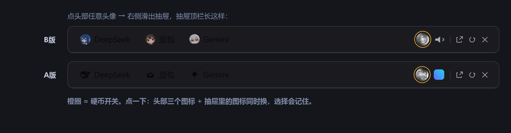

# Quick Chat

[中文](README.md) | English

[](LICENSE)
[](https://github.com/deepseek-ai/deepseek-harness)
[](CHANGELOG.md)

A row of vendor avatars in the DeepSeek Harness conversation header. Click one and that vendor's **own web chat** slides in from the right — DeepSeek, Doubao or Gemini — while the main UI makes room for it. Click again to close.

The drawer shows the site exactly as it renders: sign-in state, history, file upload and voice input all work. The plugin adds no composer of its own and no cross-vendor fan-out, so there is never a second chat box fighting the real one.



## Why not the built-in browser tab

The built-in tab creates its guest with the host's default UA (which contains `Electron/…`). `chat.deepseek.com` detects `navigator.userAgent.includes("electron")` and answers with its "unusual environment" modal, and a plugin cannot change that UA.

The main process's `will-attach-webview` only validates the lease owner and the partition — it never rewrites `params.useragent`. A webview the plugin creates can therefore carry a plain desktop Chrome UA, the check misses, and the modal never appears.

## Features

| | |
|---|---|
| **One click** | Click an avatar to slide the drawer out, click again to close; `Esc` and `×` work too |
| **All three stay warm** | One guest per vendor, kept alive — switching back does not reload or lose scroll position |
| **The main UI makes room** | The conversation actually narrows instead of being covered; drag the drawer's left edge and it follows |
| **Draggable width** | 360px up to window width − 90px, remembered locally |
| **Two icon sets** | Vector glyphs, or illustrated avatars |
| **Colours that fit the background** | Blue→cyan gradient (default) / white / blue / black / follow theme; white is hidden on a light background and black on a dark one, so it is really four options |
| **Coin switch** | A silver coin: crown side = vector glyphs, lightning side = illustrated avatars, click to flip |
| **Click sounds** | One clip per vendor, played on open; a speaker button mutes them |
| **Self-healing icons** | If the host remounts or hides the header seat, a guard notices within ~2s and re-hosts the buttons at the header's right edge |
| **Contrast-aware ink** | The picker only offers colours you can see — white is dropped on a light background, black on a dark one. White also has a fallback for skins that paint the header light |
| **UI in Chinese or English** | Labels follow the system language: `zh*` gets Chinese, everything else English |
| **No environment warning** | The self-created webview uses a desktop Chrome UA |

## Install

`engines.dsh` is `>=0.2.2-0 <0.3.0` (verified on 0.2.2-rc.3). On an older host the two seats this plugin uses may not exist, and the UI will simply do nothing.

### One command (recommended)

```sh
# Prebuilt tarball: no git clone, no build scripts run on your machine
dsh plugin --profile desktop add https://github.com/lrhero/dsh-quick-chat/releases/latest/download/dsh-quick-chat.tgz

# Or straight from the repository
dsh plugin --profile desktop add github:lrhero/dsh-quick-chat
```

Replace `desktop` with your profile name, then restart Harness. The plugin shows up under **Settings → Plugins**.

> In **DSH Desktop** the profile is managed by the app, so `dsh plugin` may install into `profiles/<name>` rather than the one the desktop app actually uses. Install through **Settings → Plugins** in that case.

> ⚠️ **The `dsh-quick-chat` package on npm is not this plugin.** The name was taken first (`youxia2026` publishes a different package under it), so this project does not publish to npm — use the two commands above. `dsh plugin add dsh-quick-chat` installs someone else's package.

### Plugin market

Search `Quick Chat` on the Plugins page's **Discover** tab and install from the card. First listing usually lands within a day of the entry being merged; if it does not show up, point the index source at `https://cdn.jsdelivr.net/npm/dsh-plugin-catalog/index.json` (see [docs/PUBLISHING.md](docs/PUBLISHING.md) for the listing process).

### Uninstall

- Disable or remove `dsh-quick-chat` under **Settings → Plugins**.
- **Remembered UI choices** stay in `localStorage` (icon style, colour, width, mute). To clear them:

```js
for (const key of ['icon-style', 'icon-color', 'voice-on', 'drawer-width', 'diag', 'debug']) {
  localStorage.removeItem(`dsh-quick-chat:${key}`);
}
```

### Overriding the configuration

The bundle's own `cordis.patch.yml` already inserts the default row (three vendors). To change vendors or icon style, override by id in the profile's `cordis.patch.yml` — do not insert a second row, the ids would collide:

```yaml
- id: quick-chat
  name: dsh-quick-chat
  config:
    iconStyle: proper
    iconColor: auto
    sources:
      - id: deepseek
        label: DeepSeek
        url: https://chat.deepseek.com/
        icon: deepseek
      - id: gemini
        label: Gemini
        url: https://gemini.google.com/app
        icon: gemini
        external: true      # Google sign-in only works in the system browser
```

## Configuration

| Field | Default | Meaning |
|---|---|---|
| `sources` | DeepSeek / Doubao / Gemini | Vendor list; entries that are not `http(s)` are dropped; a missing `label` falls back to the host name |
| `sources[].icon` | `globe` | Built-in glyph name (`deepseek` / `doubao` / `gemini` / `globe` / `chat`), or an image URL / data URI |
| `sources[].external` | `false` | `true` opens the site in the system browser |
| `sources[].surface` | `webview` | `tab` hands the page to the host's own browser tab |
| `sources[].userAgent` | desktop Chrome | `chrome` / `electron` / a full UA string |
| `iconStyle` | `proper` | `proper` = vector glyphs; `fun` = illustrated avatars (with sounds) |
| `iconColor` | `grad` | `grad` (the first-install default, blue→cyan) / `blue` / `white` / `black` / `auto` (follow theme). White is not offered on a light background and black is not offered on a dark one (a config value for them falls back to `grad`); white keeps its contrast fallback |
| `voiceVolume` | `0.7` | Click-sound volume, 0–1 |
| `voiceEnabled` | `true` | Play click sounds; the speaker button in the drawer overrides it locally |
| `voices` | empty | Per-id sound overrides as data URI or http(s) URL |
| `pushMain` | `true` | Reserve space for the drawer instead of covering the conversation |

UI choices (icon style, colour, width, mute) are stored in `localStorage` and win over the configuration on the next start.

## Known limitations

- **Sign-in does not survive a restart**: the guest partition name is generated by the main process; a plugin cannot request `persist:`.
- **Gemini may not load**: it needs a system proxy in some regions; the guest's proxy behaviour belongs to the host, and a failure shows the error code in the panel. The default configuration therefore sets `external: true`.
- **DeepSeek may be blocked by the system proxy (403)**: the guest follows the host's proxy. If the proxy exit IP is refused by DeepSeek's CloudFront you get a `403 ERROR / Request blocked` page. **Direct access works** — add `chat.deepseek.com` to the proxy bypass list (see Troubleshooting).
- **Google sign-in cannot be embedded**: Google blocks browsers it considers "embedded in another app", and no UA change gets past it, so it goes to the system browser.
- **Memory**: one guest per vendor; three open at once costs more.

## Compatibility and self-healing

The plugin hard-depends only on the `slots` service and uses two seats:

| Seat | Purpose |
|---|---|
| `conversation.session.header.utilities` | The avatar row, in its proper home |
| `shell.overlay` | The drawer, plus the guard that re-hosts the avatars |

After the host rearranges the conversation header, a seat can be remounted — or stay in the DOM while being completely invisible (zero size, `display:none` ancestor, clipped by overflow, covered, or pushed out of the viewport). The guard therefore asks whether the buttons are **actually painted**: connected, measurable box, `checkVisibility()`, viewport intersection, ancestor `overflow` clipping, and `elementFromPoint`.

When they are not, it renders a fixed group next to `[data-conversation-header-corner]` with a dark backing plate and white glyphs, above the drawer. It takes over only after two consecutive misses (no duplicate on the first frame) and retracts as soon as the original seat is visible again.

## Troubleshooting

The page records its own measurements:

```js
localStorage.getItem('dsh-quick-chat:diag')
```

| `event` | Meaning |
|---|---|
| no record | The client module never loaded — check the plugin row, restart |
| `apply` | The plugin ran; `seats` lists the registered seats (`!` marks a failure) |
| `header-mount` | The host did render the header seat |
| `snapshot` | Geometry and colour: `groups[].r`, `hit`, `bg`/`ink` |
| `push` | Reserved space `margin` and drawer `width` when opening |

`corner: null` in a `snapshot` means no conversation header was rendered at that moment (for example while sitting on the plugin manager page).

### `403 ERROR / Request blocked` in the drawer

That is the site's CDN (CloudFront) refusing the request, not the plugin. Find out who is blocking it:

```powershell
# Direct (no system proxy) — should be 200
curl.exe -s -o NUL -w "%{http_code}`n" https://chat.deepseek.com/

# Through your system proxy: a 403 here means the proxy exit IP is blocked
curl.exe -s -o NUL -w "%{http_code}`n" -x http://127.0.0.1:7890 https://chat.deepseek.com/
```

Replace `7890` with your proxy port. Direct 200 plus proxied 403 means the fix is to add `deepseek.com` to the proxy bypass / DIRECT rules, then press ⟳ in the drawer. When the panel recognises that CloudFront page it says so itself.

Only events are recorded by default. For the full geometry snapshot, turn the switch on and reload:

```js
localStorage.setItem('dsh-quick-chat:debug', '1');
location.reload();
```

Remember to clear it afterwards: `localStorage.removeItem('dsh-quick-chat:debug')`.

## Privacy

No telemetry, no data collection. The plugin only creates a webview for the vendor you clicked, and stores your icon style and drawer width in `localStorage`.

## Development

```
dsh-quick-chat/
├── client.js              the entire browser-side implementation
├── index.js               empty Host half (a placeholder)
├── cordis.patch.yml       reference configuration
├── locale/                plugin manager title and description
├── icon.png               512×512 plugin icon, also the storefront tile
├── screenshots.json       storefront screenshots, read by the market
├── docs/                  README artwork, detail-page artwork, release guide
├── market/                the one line the awesome list needs
├── .github/workflows/     CI, and Release on a version tag
├── tools/embed-*.mjs      icons / sounds / coin photos → client.js
├── tools/pack.mjs         release tarball and checksums
└── test/smoke.mjs         offline self-check; test/package.mjs checks packaging
```

Zero runtime dependencies; `client.js` is plain browser ESM and React comes from the host's module table.

```powershell
npm test                 # 23 behaviour checks + 11 packaging/metadata checks
npm run pack:check       # print the file list a release tarball would contain
```

Editing `client.js` requires a page refresh (HMR only reloads the Host half).

## Publishing

Releases, the `dsh-plugin` topic, and the awesome-list entry are documented in [docs/PUBLISHING.md](docs/PUBLISHING.md) (Chinese).

## License

[MIT](LICENSE) © 2026 lrhero
