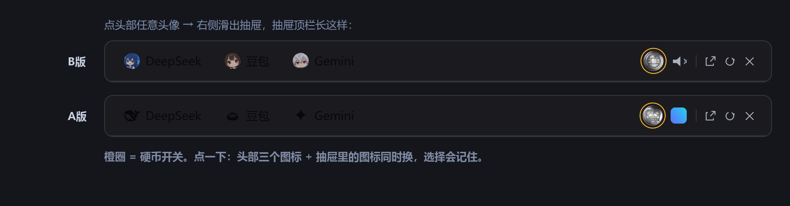
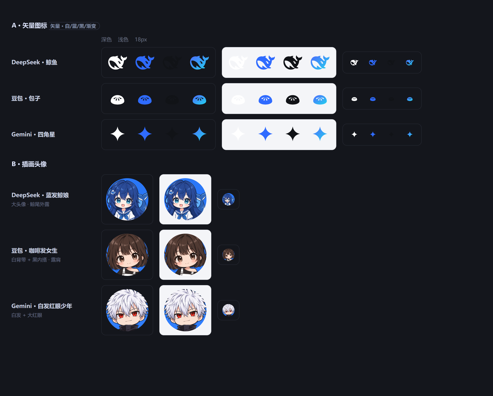
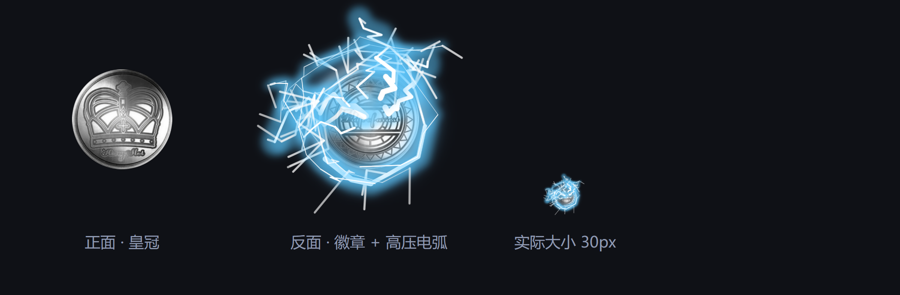

# 快捷聊天 · Quick Chat

中文 | [English](README.en.md)

[](LICENSE)
[](https://github.com/deepseek-ai/deepseek-harness)
[](CHANGELOG.md)

在 DeepSeek Harness 的会话头部放一排厂家头像：点一下，DeepSeek / 豆包 / Gemini **自己的网页版聊天**从右侧滑出，主界面自动让位；再点一下收起。

抽屉里是站点原样的完整界面——登录态、历史会话、文件上传、语音输入全都照常。插件不插入自己的输入框，也不做「多厂家同问」，所以不会出现两套聊天框互相打架。



## 为什么不用内置浏览器标签页

内置标签页的访客由宿主用默认 UA（含 `Electron/…`）创建，`chat.deepseek.com` 会检测
`navigator.userAgent.includes("electron")` 并弹「使用环境异常」，而这个 UA 插件改不了。

但主进程的 `will-attach-webview` **只校验租约所有者与 partition，从不改写 `params.useragent`**
——所以插件自建的 webview 可以带一个干净的桌面 Chrome UA，检测落空，提示不再出现。

## 功能

| | |
|---|---|
| **一键唤出** | 头部头像点一下滑出，再点一下收起；`Esc`、`×` 也能关 |
| **三家常驻** | 每家用一个独立 guest，切回来不重载、不丢滚动位置 |
| **主界面让位** | 打开抽屉时主内容真的收窄（不是盖住）；拖抽屉左缘改宽，主界面跟着变 |
| **可拖拽宽度** | 360px ~ 窗口宽−90px，宽度记在本地 |
| **两套图标** | A 版 = 矢量图标；B 版 = 插画头像 |
| **配色随底色收敛** | 渐变（默认，蓝→青）/ 白 / 浅蓝 / 深黑 / 跟随主题；浅色底不提供白、深色底不提供黑，实际是 4 档 |
| **硬币开关** | 一枚银色硬币，正面皇冠 = A 版，反面带电 = B 版，点击翻面 |
| **点击音效** | 每家一段专属音频，点哪个响哪个；喇叭按钮一键静音 |
| **丢了会自己回来** | 宿主重排头部（折叠侧栏、切会话、窗口缩放）后席位可能失效；守卫按「真的画出来了吗」判定，2 秒内把按钮补到头部右上角 |
| **配色自适应** | 选项按底色收敛：浅色底隐藏「白」、深色底隐藏「黑」，所以永远不会选中一个看不见的颜色。白色另有一层兜底（皮肤把头部刷成浅色时自动变深） |
| **界面中英双语** | 文案跟随系统语言：`zh*` 用中文，其余用英文 |
| **不弹环境异常** | 自建 webview 使用桌面 Chrome UA |

## 安装

`engines.dsh` 声明为 `>=0.2.2-0 <0.3.0`（在 0.2.2-rc.3 实测）。低于该版本时，插件用到的两个席位可能不存在，界面不会有任何反应。

### 方式 A：一条命令（推荐）

```sh
# 预构建包：不需要 git，也不在本机跑任何构建脚本
dsh plugin --profile desktop add https://github.com/lrhero/dsh-quick-chat/releases/latest/download/dsh-quick-chat.tgz

# 或者直接从仓库装
dsh plugin --profile desktop add github:lrhero/dsh-quick-chat
```

把 `desktop` 换成你自己的 profile 名。装完重启 Harness；插件会出现在 **设置 → 插件** 列表里，可以随时启用/停用。

> 在 **DSH Desktop** 里 profile 由应用托管，`dsh plugin` 可能装进 `profiles/<name>` 而不是桌面端实际使用的那一份——桌面端直接在 **设置 → 插件** 里安装即可。

### 方式 B：插件市场

插件页的 **发现（Discover）** 页签里搜 `Quick Chat`，点卡片上的安装即可。首次收录通常在上架后一天内；刷不到时把索引源换成 `https://cdn.jsdelivr.net/npm/dsh-plugin-catalog/index.json`（上架与发布流程见 [docs/PUBLISHING.md](docs/PUBLISHING.md)）。

### 卸载

- 在 **设置 → 插件** 里停用或移除 `dsh-quick-chat`
- **界面记忆**留在 `localStorage`（图标样式、配色、宽度、静音），需要一并清掉：

```js
for (const key of ['icon-style', 'icon-color', 'voice-on', 'drawer-width', 'diag', 'debug']) {
  localStorage.removeItem(`dsh-quick-chat:${key}`);
}
```

### 配置项（可选）

bundle 自带的 `cordis.patch.yml` 已经插好默认配置（三家站点）。想改站点或图标样式，在
profile 的 `cordis.patch.yml` 里按 id 覆盖即可——**不要重复 insert，会撞 id**：

```yaml
- id: quick-chat
  name: dsh-quick-chat
  config:
    iconStyle: proper
    iconColor: auto
    sources:
      - id: deepseek
        label: DeepSeek
        url: https://chat.deepseek.com/
        icon: deepseek
      - id: doubao
        label: 豆包
        url: https://www.doubao.com/chat/
        icon: doubao
      - id: gemini
        label: Gemini
        url: https://gemini.google.com/app
        icon: gemini
        external: true      # Google 登录只能交给系统浏览器
```

## 配置

| 字段 | 默认值 | 说明 |
|---|---|---|
| `sources` | DeepSeek / 豆包 / Gemini | 站点列表；非 `http(s)` 条目丢弃；缺 `label` 用域名 |
| `sources[].icon` | `globe` | 内置矢量图标名（`deepseek` / `doubao` / `gemini` / `globe` / `chat`），也可以是图片 URL 或 data URI |
| `sources[].external` | `false` | `true` = 点这个源直接用系统浏览器打开（Google 登录只能这样） |
| `sources[].surface` | `webview` | `tab` = 交给宿主自带的浏览器标签页 |
| `sources[].userAgent` | 桌面 Chrome | `chrome` / `electron` / 完整 UA 字符串 |
| `iconStyle` | `proper` | `proper` = A 版矢量图标；`fun` = B 版插画头像（点击带音效） |
| `iconColor` | `grad` | `grad`（首次安装默认，蓝→青渐变）/ `blue` / `white` / `black` / `auto`（跟随主题）。浅色底不提供 `white`、深色底不提供 `black`（写进配置也会退回 `grad`）；`white` 另有对比度兜底 |
| `voiceVolume` | `0.7` | 点击音效音量，0~1 |
| `voiceEnabled` | `true` | 是否播放点击音效；界面上的喇叭按钮也能开关，本地记忆优先 |
| `voices` | 空 | 按 id 覆盖音效，值是 data URI 或 http(s) 地址；留空用内置音效 |
| `pushMain` | `true` | 打开抽屉时是否让主界面收窄；设 `false` 则变成纯覆盖 |
| `iconStyle` / `iconColor` 的界面记忆 | — | 抽屉里切换过就存 `localStorage`，下次启动沿用；配置只是初值 |

想恢复配置默认值：

```js
localStorage.removeItem('dsh-quick-chat:icon-style');
localStorage.removeItem('dsh-quick-chat:icon-color');
```

## 用起来是什么样

- **会话头部右侧**：一排厂家头像，点一下滑出抽屉，再点一下收起
- **抽屉顶栏**：厂家按钮 ｜ 硬币（换图标）· 色点（换配色）/ 喇叭（静音）｜ ↗ 系统浏览器 · ⟳ 刷新 · × 关闭
- **抽屉左缘**：拖动改宽度；**没有遮罩层**，主窗口照常可点可聊，点外面不会关掉抽屉
- **主界面让位**：抽屉占多少，主内容就让多少（宿主右栏已占的部分不重复让）

## 两套图标

| `iconStyle` | 效果 |
|---|---|
| `proper` | 鲸鱼 / 包子 / 四角星，颜色由 `iconColor` 决定 |
| `fun` | 蓝发鲸娘 / 咖啡发女生 / 白发红眼少年，96px 圆图内嵌 |



B 版头像从 `assets/icons/<id>-96.png` 生成，内嵌成 data URI（webview 里解析相对路径不可靠）。换图后重跑：

```powershell
node tools/embed-icons.mjs
```

抽屉里的硬币负责切换：正面皇冠 = A 版，反面带电 = B 版，翻转动画 420ms；B 版硬币外圈还有不规则的白蓝放电。



## 点击音效

点头部任意厂家图标 → 播一次该厂家的音频（与图标样式无关，一次点击放一遍，连点会打断上一段）。
音效只在「打开」那一下播放，关闭时不响。

换音频就放进 `assets/voice/<id>.mp3`，然后：

```powershell
node tools/embed-voice.mjs
```

脚本会把音频转成 data URI 写进 `client.js` 的 `VOICES`。支持 mp3 / wav / ogg / m4a / aac / flac。

## 已知限制

- **登录不跨重启**：guest 的分区名由主进程随机生成，插件无法指定 `persist:`，应用退出即清空。
- **Gemini 可能加载不出来**：国内直连不通，只有走系统代理才通；guest 是否走代理取决于宿主，失败时面板会显示错误码。所以默认把 Gemini 配成 `external: true`。
- **DeepSeek 可能被系统代理挡住（403）**：guest 跟随宿主走系统代理。如果代理的出口 IP 被 DeepSeek 的 CloudFront 拦了，页面会是一张 `403 ERROR / Request blocked`。**直连是通的**，把 `chat.deepseek.com` 加进代理直连规则即可（见下面「排查」）。
- **Google 登录不能内嵌**：Google 会拦「嵌入在其他应用中」的浏览器，改 UA 也过不去（实测 `userAgent: electron` 仍被拦），只能交给系统浏览器。
- 每个厂家一个 guest，三家都开时内存占用上升。

## 兼容性与自愈行为

`engines.dsh: >=0.2.2-0 <0.3.0`。插件只硬依赖 `slots` 服务，用了两个席位：

| 席位 | 用途 |
|---|---|
| `conversation.session.header.utilities` | 头部那一排头像（正位） |
| `shell.overlay` | 抽屉本体 + 守卫补位组 |

宿主重排会话头部后，席位可能整段重挂，也可能**还留在 DOM 里却整段不可见**（0 宽、祖先 `display:none`、被 overflow 裁掉、被别的层盖住、被推出视口）。守卫判定的是「那组按钮真的画出来了吗」：

- 判据：连在文档上 + 实测盒子 + `checkVisibility()` + 视口相交 + 祖先 `overflow` 裁切 + `elementFromPoint` 落点
- 看不见 → 在 `shell.overlay` 补一组固定定位按钮，贴着 `[data-conversation-header-corner]` 的实测位置，底片固定深色 + 白色图标，层级高于抽屉
- 连续两次探不到才接管（首帧不会闪出重复按钮）；原席位恢复可见后立刻撤掉自己

## 排查

页面会把自己的实测结果写进 localStorage：

```js
localStorage.getItem('dsh-quick-chat:diag')
```

| `event` | 含义 |
|---|---|
| 无记录 | 客户端模块没加载 → 看「设置 → 插件」里是否启用，重启应用 |
| `apply` | 插件跑起来了，`seats` 是注册成功的席位（带 `!` 的是失败项） |
| `header-mount` | 头部席位确实被宿主渲染了 |
| `snapshot` | 几何与配色实测：`groups[].r` 位置、`hit` 落点、`bg`/`ink` 对比度 |
| `push` | 打开抽屉时的让位量 `margin` 与抽屉宽度 `width` |

默认只记事件本身；要看完整几何测量（`snapshot`），先开开关再刷新：

```js
localStorage.setItem('dsh-quick-chat:debug', '1');
location.reload();
```

排查完记得删掉：`localStorage.removeItem('dsh-quick-chat:debug')`。

`snapshot` 里 `corner: null` 表示当时根本没渲染会话头部（例如停在插件管理页），不是插件的问题。

### 面板里出现 `403 ERROR / Request blocked`

这不是插件拦的，是站点的 CDN（CloudFront）拒绝了这次请求。先分清是谁挡的：

```powershell
# 直连（绕开系统代理）——正常应返回 200
curl.exe -s -o NUL -w "%{http_code}`n" https://chat.deepseek.com/

# 走你的系统代理：如果这里返回 403，就是代理的出口 IP 被站点拦了
curl.exe -s -o NUL -w "%{http_code}`n" -x http://127.0.0.1:7890 https://chat.deepseek.com/
```

`7890` 换成你代理的端口。结论与做法：

| 直连 | 走代理 | 含义 | 做法 |
|---|---|---|---|
| 200 | 403 | 代理出口 IP 被 CloudFront 拦 | 把 `chat.deepseek.com;*.deepseek.com` 加进系统代理的**直连/绕过**列表（代理软件里：`DOMAIN-SUFFIX,deepseek.com,DIRECT`），然后点抽屉里的 ⟳ |
| 403 | 403 | 本机 IP 或网络被拦 | 换网络/节点，或直接用系统浏览器打开 |
| 200 | 200 | 不是网络问题 | 先点 ⟳；仍不行看一下 guest 的 UA（按钮 title 里有实际 UA） |

面板识别到这张 CloudFront 页时会自己显示上面这段结论里对应的提示，不用先猜。

## 隐私

插件本身不收集、不上传任何数据，也没有遥测。它做的只有两件事：在你点某个厂家时创建该站点的 webview（访问的就是你点的那家站点），以及把你在这台机器上选的图标样式/宽度记在 `localStorage`。

## 开发

```
dsh-quick-chat/
├── client.js              浏览器端全部实现（含内嵌头像、音效、硬币）
├── index.js               服务端空实现（插件占位）
├── cordis.patch.yml       参考配置
├── locale/                插件管理器里的标题与描述
├── icon.png               插件图标（512×512，商店卡片也用它）
├── screenshots.json       商店卡片截图（最多 8 张，给市场读）
├── docs/                  README 配图、插件详情页配图、发布手册
├── assets/icons/          头像源图 96 / 192
├── assets/voice/          音效源文件
├── market/                上架 awesome-dsh-plugin 用的条目（一条 YAML）
├── .github/workflows/     CI（测试）+ Release（打 tag 自动发 tarball）
├── tools/embed-icons.mjs  头像 → client.js
├── tools/embed-voice.mjs  音效 → client.js
├── tools/embed-coin.mjs   硬币照片 → client.js
├── tools/pack.mjs         出 Release 用的 tarball + 校验和
└── test/smoke.mjs         功能自检；test/package.mjs 打包与元数据自检
```

- 零运行时依赖，`client.js` 是纯浏览器端 ESM，React 由宿主的模块表提供。
- 离线自检（不需要 DSH、不需要网络）：

```powershell
npm test                 # 25 项功能断言 + 11 项打包/元数据断言
npm run pack:check       # 只看 tarball 里到底会装进去哪些文件
```

覆盖：席位注册、来源归一化、厂家按钮、抽屉里没有多余的自研聊天 UI、无桌面桥时退回侧栏标签、
`iconStyle=fun` 内嵌头像、缺图来源退回 glyph、音效开关、配色循环与渐变、让位算式、守卫的四种可见性形态、配色对比度兜底。

打包自检另外保证：包名 / Loader 行名 / 客户端模块 id 三者一致、`dsh.bundle` 与 `engines.dsh` 在位、
`locale` 的 `meta.detail` 指向的文件与图片真的在包里、图标是有效 PNG 且不超 256 KiB、
`screenshots.json` 的路径合法、`files` 既覆盖运行时文件又不夹带 `test/` `tools/` `assets/`、
版本号在 `package.json` / `CHANGELOG.md` / README 徽章三处一致。

- 改 `client.js` 后需要刷新页面（HMR 只热更 Host 端）。
- 发布与上架流程见 [docs/PUBLISHING.md](docs/PUBLISHING.md)。

## 许可

[MIT](LICENSE) © 2026 lrhero
